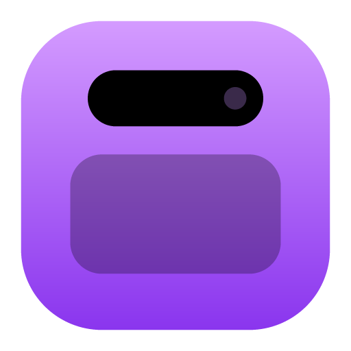
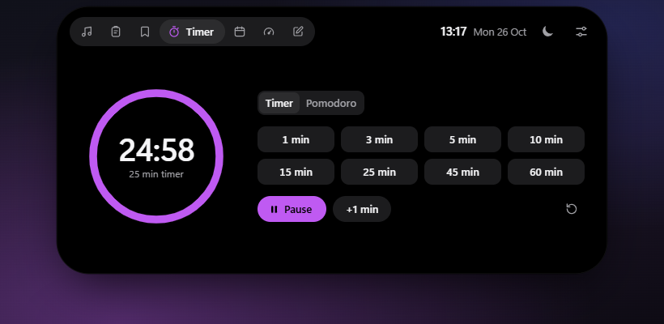

<div align="center">



# Islet

**A Dynamic Island–style top bar for Windows.**
A small black pill with the time at the top of your screen that opens into a panel with media controls, clipboard history, bookmarks, a timer, your calendar, system stats and notes.

[Русский](README.md) · [Download](https://github.com/Nikitazis/islet/releases/latest)

</div>



## Features

- **Media.** Whatever plays in Windows' media flyout: Spotify, YouTube and other sites in your browser, Windows Media Player. Artwork, seeking, play/pause, next/previous and volume. Scroll the mouse wheel over the pill to change the system volume.
- **Clipboard history.** Text, links, images and copied files, kept across restarts. Search, pin, click to copy again. Entries that password managers mark as secret are never recorded.
- **Quick paste.** <kbd>Ctrl</kbd> + <kbd>Shift</kbd> + <kbd>V</kbd> anywhere opens the history with the search focused; <kbd>Enter</kbd> pastes the entry into the window you were in.
- **Timer and Pomodoro.** A running countdown shows right in the pill as a live activity: a ring and the minutes left.
- **Calendar.** The month, the selected day's events and a reminder five minutes before each one. Add your own events, or paste an iCal link from Google Calendar or Outlook in settings (recurring events, exceptions and time zones are handled).
- **System.** CPU, memory, disk, network speed, battery and uptime, sampled only while the section is open.
- **Notes.** Quick notes that save themselves.
- **Bookmarks.** Websites, files and folders; names and icons come from the site itself.
- **Stays out of the way.** Over a program window, such as a maximized browser's tabs, the pill shrinks to a slim click-through handle at the screen edge. It hides during fullscreen games and videos. There's Do Not Disturb, and four ways to open it: instantly, on rest, by pushing the pointer to the top edge, or only with a click.

The interface follows the Windows language (Russian or English) and can be switched in settings.

## Install

Download `Islet-Setup-….exe` or the portable build from [Releases](https://github.com/Nikitazis/islet/releases/latest). The installed version updates itself.

The build isn't code-signed yet, so on first launch Windows shows "Windows protected your PC". Click "More info", then "Run anyway".

Requires Windows 10 1809 or later.

## Develop

```bash
git clone https://github.com/Nikitazis/islet.git
cd islet
npm install
npm start
```

`npm run preview` serves the interface with demo data at http://localhost:5173 (add `?lang=en`). `npm test` and `npm run check` run the tests and checks that CI runs. To publish a version, run `npm version minor` and `git push --follow-tags`: GitHub Actions builds the installer and attaches it to a release.

## License

[MIT](LICENSE)
