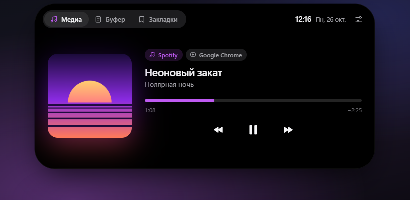
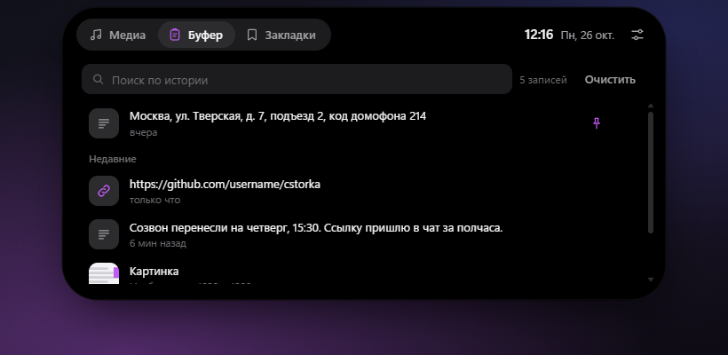
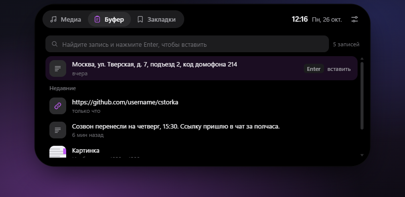
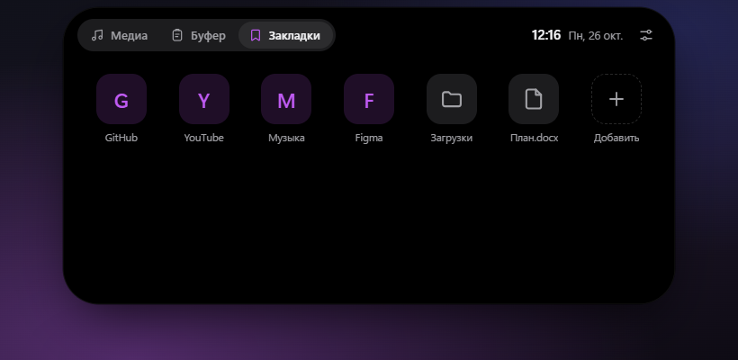
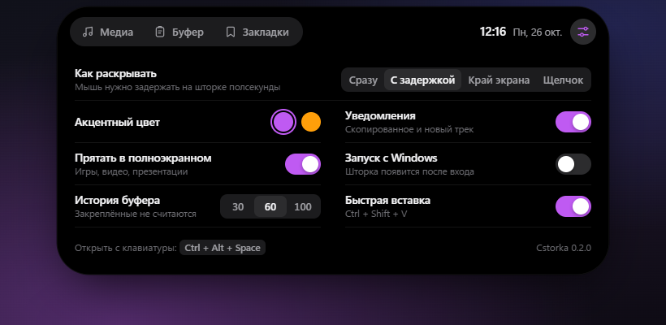
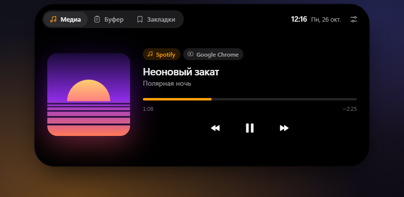

<div align="center">


# Cstorka

**Шторка в стиле Dynamic Island для Windows.**
Маленькая чёрная пилюля с часами у верхнего края экрана, которая раскрывается в панель с плеером, историей буфера обмена и закладками.

<sub>A Dynamic Island–style top bar for Windows: now playing, clipboard history and bookmarks.</sub>


</div>



## Что умеет

**Медиа.** Показывает всё, что играет в Windows и попадает в системную плашку управления музыкой: Spotify, YouTube и другие сайты в Chrome, Edge и Firefox, Медиаплеер Windows и другие плееры. Обложка, перемотка по клику, пауза, следующий и предыдущий трек. Если звук идёт из нескольких мест, сверху появляются переключатели. Видео шторка узнаёт по широкому кадру и показывает его в формате 16:9.

**Буфер обмена.** Запоминает скопированный текст, ссылки и картинки, история сохраняется между перезапусками. Поиск, закрепление важного, щелчок по записи копирует её снова. Пароли из менеджеров паролей не записываются: шторка уважает ту же метку, что и встроенный журнал Windows (Win + V).

**Быстрая вставка.** <kbd>Ctrl</kbd> + <kbd>Shift</kbd> + <kbd>V</kbd> в любой программе открывает историю с курсором в поиске. Начните печатать, выберите запись стрелками и нажмите <kbd>Enter</kbd>: она вставится туда, где вы работали, причём без форматирования. <kbd>Esc</kbd> возвращает фокус обратно, ничего не вставляя.

**Не мешает.** Шторка прячется, пока впереди игра, видео или презентация на весь экран, и возвращается, когда вы из них выходите. Раскрываться она может сразу, с задержкой, только когда мышь упирается в верхний край экрана, или только по щелчку. Пока зажата кнопка мыши (например, вы тащите вкладку браузера), шторка не открывается.

**Закладки.** Сайты, файлы и папки одним щелчком. Название и иконка подтягиваются с самого сайта, без сторонних сервисов. Порядок меняется перетаскиванием.

**Уведомления.** Когда вы что-то копируете или начинается новый трек, пилюля на пару секунд вытягивается и показывает, что произошло.

| Буфер обмена | Быстрая вставка |
| --- | --- |
|  |  |
| **Закладки** | **Настройки** |
|  |  |
| **Уведомление** | **Оранжевая тема** |
|  |  |

## Управление

| Что сделать | Как |
| --- | --- |
| Открыть | Навести мышь на пилюлю (как именно — выбирается в настройках), щёлкнуть по ней или нажать <kbd>Ctrl</kbd> + <kbd>Alt</kbd> + <kbd>Space</kbd>¹ |
| Вставить из истории | <kbd>Ctrl</kbd> + <kbd>Shift</kbd> + <kbd>V</kbd>, затем <kbd>Enter</kbd> |
| Оставить открытой | Щёлкнуть по пустому месту шторки |
| Закрыть | Увести мышь, щёлкнуть мимо или нажать <kbd>Esc</kbd> |
| Переключить раздел | <kbd>1</kbd>, <kbd>2</kbd>, <kbd>3</kbd> |
| Пауза | <kbd>Space</kbd> в разделе «Медиа» |
| Поиск по буферу | <kbd>/</kbd> или <kbd>Ctrl</kbd> + <kbd>F</kbd> |

¹ Если сочетание занято другой программой (например, приложением Claude), шторка возьмёт <kbd>Alt</kbd> + <kbd>Shift</kbd> + <kbd>Space</kbd> или <kbd>Ctrl</kbd> + <kbd>Alt</kbd> + <kbd>C</kbd>. Какое сочетание досталось, видно внизу настроек.

Вокруг шторки окно прозрачно для мыши: клики проходят в программы под ней. Щелчки по кнопкам плеера не забирают фокус у окна, в котором вы работаете. Сочетания клавиш работают и поверх полноэкранных приложений. В трее есть меню с основными настройками и выходом.

Пара оговорок про быструю вставку:
- <kbd>Ctrl</kbd> + <kbd>Shift</kbd> + <kbd>V</kbd> в браузерах и Word и так означает «вставить без форматирования», а в VS Code открывает предпросмотр Markdown. Пока быстрая вставка включена, это сочетание перехватывает шторка. Выключается в настройках.
- В программы, запущенные от имени администратора, Windows не даёт отправить нажатие клавиш. Запись тогда просто копируется, и шторка подсказывает вставить её через <kbd>Ctrl</kbd> + <kbd>V</kbd>.

## Установка

Нужны Windows 10 1809 или новее и [Node.js](https://nodejs.org) 20+.

```bash
git clone https://github.com/<Nikita>/cstorka.git
cd cstorka
npm install
npm start
```

Собрать установщик и portable-версию в папку `dist`:

```bash
npm run dist
```

## Разработка

| Команда | Что делает |
| --- | --- |
| `npm start` | Запускает шторку |
| `npm run dev` | То же, плюс DevTools |
| `npm run preview` | Интерфейс в обычном браузере на демо-данных: http://localhost:5173 |
| `npm run screenshots` | Пересобирает картинки для этого README |
| `npm run icon` | Перерисовывает иконку приложения и трея |
| `npm run dist` | Установщик NSIS и portable `.exe` |

```
src/
├── main/                  процесс Electron
│   ├── main.js            окно, трей, горячие клавиши, полноэкранный режим, IPC
│   ├── win32.js           вызовы Windows через koffi: какое окно впереди, фокус, Ctrl+V
│   ├── media-bridge.ps1   читает медиасессии Windows и выполняет команды плеера
│   ├── media.js           запускает мост и разбирает его ответы
│   ├── clipboard.js       история буфера обмена
│   ├── bookmarks.js       закладки, названия и иконки сайтов
│   ├── store.js           хранилище настроек и данных
│   └── preload.js         безопасный мост к интерфейсу
└── renderer/              интерфейс без фреймворков
    ├── app.js             состояния шторки, наведение, уведомления
    ├── styles.css
    ├── lib/spring.js      пружинная физика, превращённая в CSS linear()
    ├── views/             разделы: медиа, буфер, закладки, настройки
    └── dev/mock.js        демо-данные для npm run preview
```

### Как это работает

- **Форма шторки** анимируется обычными CSS-переходами, но кривая скорости рассчитана симуляцией пружины (`lib/spring.js`): при раскрытии шторка чуть перелетает и мягко садится, как на iPhone.
- **Медиа** читаются через системный API Windows Global System Media Transport Controls. Это делает небольшой PowerShell-скрипт, который работает в фоне и отвечает строками JSON. Скрипт передаётся через `-Command`, поэтому политику выполнения PowerShell менять не нужно. Нагрузка — доли процента одного ядра.
- **Окно** — прозрачный холст поверх всех окон. Пока курсор не над шторкой, Windows пропускает клики сквозь него.
- **Полноэкранный режим** определяется так: окно впереди закрывает весь монитор шторки и не имеет рамки. Развёрнутые окна рамку сохраняют, поэтому шторку не прячут даже при скрытой панели задач.
- **Быстрая вставка** запоминает окно, где нажали сочетание, кладёт запись в буфер, возвращает этому окну фокус и нажимает за вас <kbd>Ctrl</kbd> + <kbd>V</kbd>. Нажатие отправляется, только если впереди действительно то самое окно.
- **Данные** лежат в `%APPDATA%\Cstorka\cstorka.json`, картинки из буфера — рядом, в `clipboard-images`. В сеть шторка обращается только к сайту, который вы добавляете в закладки.

## Планы

- [x] Прятать шторку в полноэкранных играх и видео
- [x] Быстрая вставка из истории буфера
- [ ] Новые разделы
- [ ] Выбор монитора для шторки
- [ ] Английский интерфейс

## Лицензия

[MIT](LICENSE)
