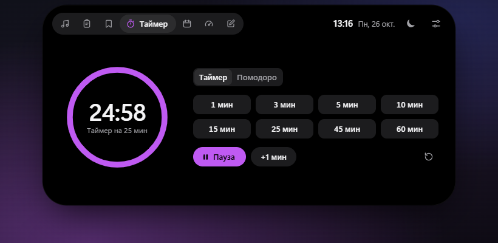
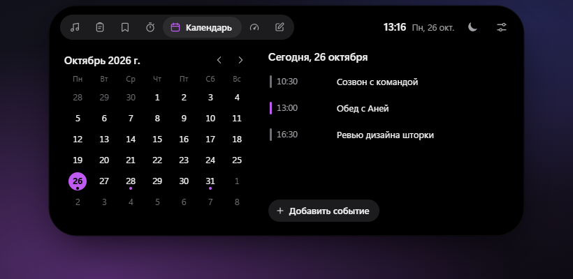
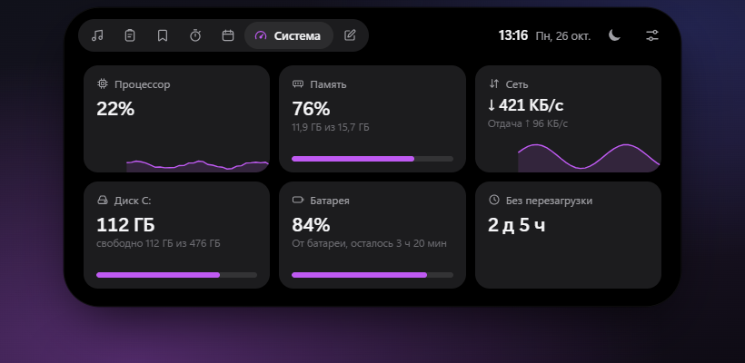
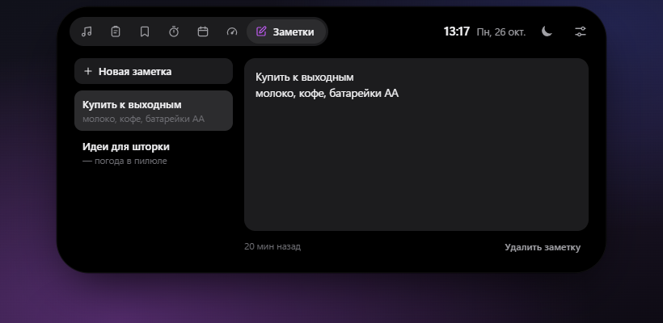

<div align="center">


# Islet

**Шторка в стиле Dynamic Island для Windows.**
Маленькая чёрная пилюля с часами у верхнего края экрана, которая раскрывается в панель с плеером, буфером обмена, закладками, таймером, календарём, состоянием системы и заметками.

[English](README.en.md) · [Скачать](https://github.com/Nikitazis/islet/releases/latest)


</div>


## Что умеет

**Медиа.** Всё, что играет в Windows и попадает в системную плашку управления музыкой: Spotify, YouTube и другие сайты в браузерах, Медиаплеер Windows. Обложка, перемотка, пауза, переключение треков и громкость. Видео шторка узнаёт по широкому кадру. Колесо мыши над пилюлей меняет громкость системы.

**Буфер обмена.** Запоминает текст, ссылки, картинки и скопированные файлы, история сохраняется между перезапусками. Поиск, закрепление, щелчок копирует запись снова. Пароли из менеджеров паролей не записываются: шторка уважает ту же метку, что и журнал Windows (Win + V).

**Быстрая вставка.** <kbd>Ctrl</kbd> + <kbd>Shift</kbd> + <kbd>V</kbd> в любой программе открывает историю с курсором в поиске. Выберите запись и нажмите <kbd>Enter</kbd> — она вставится туда, где вы работали. Файлы вставляются в Проводник так же.

**Таймер и помодоро.** Пока идёт отсчёт, он виден прямо в пилюле — кольцом и минутами, как «живая активность» на iPhone. Помодоро сам переключает 25 минут работы и 5 минут отдыха, а после четырёх раундов даёт длинный перерыв.

**Календарь.** Месяц, события на выбранный день и напоминание за 5 минут до начала. Свои события можно добавить прямо в шторке. Чтобы видеть встречи из Google Календаря или Outlook, вставьте в настройки их iCal-ссылку: повторяющиеся встречи, исключения и часовые пояса учитываются.

**Система.** Процессор, память, диск, скорость сети, батарея ноутбука и время без перезагрузки. Данные собираются только пока раздел открыт.

**Заметки.** Быстрые записи, которые сохраняются сами. Пустые заметки удаляются, когда вы уходите из них.

**Закладки.** Сайты, файлы и папки одним щелчком. Название и иконка подтягиваются с самого сайта, порядок меняется перетаскиванием.

**Не мешает.** Над окнами программ — например, над вкладками развёрнутого браузера — пилюля сжимается в тонкое «ушко» у края экрана и пропускает клики. В полноэкранных играх и видео шторка прячется. Есть режим «Не беспокоить» (луна в шапке) и четыре способа раскрытия: сразу, с задержкой, упором мыши в край экрана или только щелчком.

| Таймер | Календарь |
| --- | --- |
|  |  |
| **Система** | **Заметки** |
|  |  |
| **Буфер обмена** | **Быстрая вставка** |
|  |  |
| **Закладки** | **Настройки** |
|  |  |
| **Уведомление** | **Оранжевая тема** |
|  |  |

## Установка

Скачайте `Islet-Setup-….exe` или portable-версию со страницы [Releases](https://github.com/Nikitazis/islet/releases/latest). Установленная версия обновляется сама: новая версия скачивается в фоне, а перезапустить шторку можно в настройках.

Сборка пока не подписана сертификатом, поэтому при первом запуске Windows покажет окно «Windows защитила ваш компьютер». Нажмите «Подробнее», затем «Выполнить в любом случае».

Нужна Windows 10 1809 или новее.

## Управление

| Что сделать | Как |
| --- | --- |
| Открыть | Навести мышь на пилюлю, щёлкнуть по ней или нажать <kbd>Ctrl</kbd> + <kbd>Alt</kbd> + <kbd>Space</kbd>¹ |
| Вставить из истории | <kbd>Ctrl</kbd> + <kbd>Shift</kbd> + <kbd>V</kbd>, затем <kbd>Enter</kbd> |
| Изменить громкость | Колесо мыши над пилюлей |
| Оставить открытой | Щёлкнуть по пустому месту шторки |
| Закрыть | Увести мышь, щёлкнуть мимо или нажать <kbd>Esc</kbd> |
| Переключить раздел | <kbd>1</kbd>–<kbd>7</kbd> |
| Пауза музыки или таймера | <kbd>Space</kbd> |
| Поиск по буферу | <kbd>/</kbd> или <kbd>Ctrl</kbd> + <kbd>F</kbd> |

¹ Оба сочетания можно поменять в настройках: щёлкните по кнопке и нажмите новое. Если сочетание для открытия не выбрано и <kbd>Ctrl</kbd> + <kbd>Alt</kbd> + <kbd>Space</kbd> занято (например, приложением Claude), шторка возьмёт <kbd>Alt</kbd> + <kbd>Shift</kbd> + <kbd>Space</kbd> или <kbd>Ctrl</kbd> + <kbd>Alt</kbd> + <kbd>C</kbd>.

Вокруг шторки окно прозрачно для мыши: клики проходят в программы под ней, а щелчки по кнопкам плеера не забирают фокус у окна, в котором вы работаете. В трее есть меню с основными настройками и выходом.

Пара оговорок про быструю вставку:
- <kbd>Ctrl</kbd> + <kbd>Shift</kbd> + <kbd>V</kbd> в браузерах и Word означает «вставить без форматирования», а в VS Code открывает предпросмотр Markdown. Пока это сочетание назначено шторке, оно достаётся ей. Его можно поменять или выключить.
- В программы, запущенные от имени администратора, Windows не даёт отправить нажатие клавиш. Тогда запись просто копируется, и шторка подсказывает вставить её через <kbd>Ctrl</kbd> + <kbd>V</kbd>.

## Разработка

Нужен [Node.js](https://nodejs.org) 20+.

```bash
git clone https://github.com/Nikitazis/islet.git
cd islet
npm install
npm start
```

| Команда | Что делает |
| --- | --- |
| `npm start` | Запускает шторку |
| `npm run dev` | То же, плюс DevTools |
| `npm run preview` | Интерфейс в обычном браузере на демо-данных: http://localhost:5173 (`?lang=en`, `?state=expanded&tab=timer`) |
| `npm test` | Тесты календаря и таймера |
| `npm run check` | Синтаксис всех скриптов и полнота переводов |
| `npm run screenshots` | Пересобирает картинки для README |
| `npm run dist` | Установщик и portable `.exe` в папке `dist` |

**Выпуск версии.** Поднимите версию и отправьте тег — GitHub Actions соберёт установщик и выложит его в Releases вместе с файлом для автообновления:

```bash
npm version minor
```

```bash
git push --follow-tags
```

```
src/
├── locales/               тексты интерфейса: ru.json, en.json
├── main/                  процесс Electron
│   ├── main.js            окно, трей, горячие клавиши, полноэкранный режим, IPC
│   ├── win32.js           вызовы Windows через koffi: окно впереди, фокус, Ctrl+V
│   ├── win-bridge.ps1     медиасессии, громкость и файлы в буфере через PowerShell
│   ├── bridge.js          запускает мост и разбирает его ответы
│   ├── clipboard.js       история буфера обмена
│   ├── calendar.js        свои события, iCal-ссылки, напоминания
│   ├── system.js          процессор, память, диск, сеть, батарея
│   ├── bookmarks.js       закладки, названия и иконки сайтов
│   ├── updater.js         обновления с GitHub Releases
│   ├── store.js           хранилище настроек и данных
│   └── preload.js         безопасный мост к интерфейсу
└── renderer/              интерфейс без фреймворков
    ├── app.js             состояния шторки, вкладки, уведомления, «живая активность»
    ├── lib/               пружины, таймер, переводы, форматы, иконки
    ├── views/             разделы
    └── dev/mock.js        демо-данные для npm run preview
```

### Как это работает

- **Форма шторки** анимируется CSS-переходами, но кривая скорости рассчитана симуляцией пружины (`lib/spring.js`): при раскрытии шторка чуть перелетает и мягко садится, как на iPhone.
- **Медиа и громкость** читаются через системные API Windows (Global System Media Transport Controls и Core Audio). Это делает небольшой PowerShell-скрипт, который работает в фоне и отвечает строками JSON. Скрипт передаётся через `-Command`, поэтому политику выполнения PowerShell менять не нужно.
- **«Ушко»** включается так: дважды в секунду шторка спрашивает у Windows, какое окно получило бы щелчок под пилюлей. Если это окно программы, а не рабочий стол, панель задач или виджет вроде Rainmeter, пилюля сжимается.
- **Полноэкранный режим** — это окно впереди, которое закрывает весь монитор и не имеет рамки. Развёрнутые окна рамку сохраняют, поэтому шторку не прячут.
- **Быстрая вставка** запоминает окно, где нажали сочетание, кладёт запись в буфер, возвращает этому окну фокус и нажимает за вас <kbd>Ctrl</kbd> + <kbd>V</kbd> — только если впереди действительно то самое окно.
- **Данные** лежат в `%APPDATA%\Islet\islet.json`, картинки из буфера — рядом, в `clipboard-images`. В сеть шторка обращается только к сайтам из закладок, к вашей iCal-ссылке и к GitHub за обновлениями.

## Лицензия

[MIT](LICENSE)
